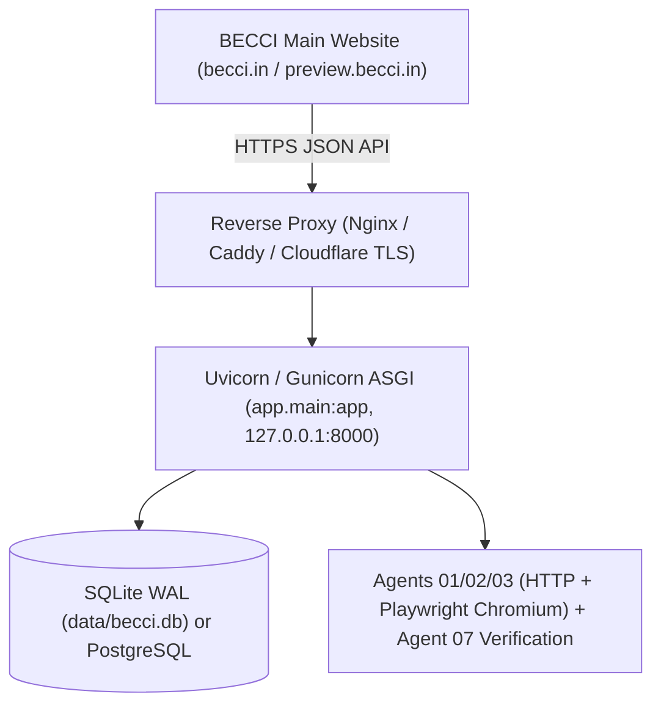

# BECCI Website Integration Handoff Package
## Complete Backend API & Integration Reference for the Main Website Team

**Backend Service:** BECCI Opportunity Intelligence Engine (`app.main:app`)  
**API Version:** `3.0.0`  
**OpenAPI Specification:** `docs/openapi.json` (OpenAPI `3.1.0`, generated directly from `app.openapi()`)  
**Handoff Date:** 2026-11-19  
**Scope:** Integration of the separate BECCI main website workspace with the existing FastAPI Opportunity Engine via HTTPS APIs — without duplicating backend logic or merging repositories.

---

## 1. OpenAPI Specification

The authoritative machine-readable OpenAPI 3.1.0 schema is exported directly from `app.main:app` at:

- **File:** `docs/openapi.json` (37 paths, 42 operations, 33 component schemas)
- **Live Swagger UI:** `<API_BASE_URL>/docs`
- **Live ReDoc:** `<API_BASE_URL>/redoc`
- **Live OpenAPI JSON:** `<API_BASE_URL>/openapi.json`

Use `docs/openapi.json` to generate TypeScript types (`openapi-typescript`) or validate API contracts in CI.

---

## 2. Complete API Endpoint Inventory (Verified Against `app.openapi()`)

Every endpoint below exists in the current FastAPI application. No unimplemented endpoints are listed.

### 2.1 Public Opportunity API (`/api/v1/*` — No Authentication)
Exposes **only** opportunities where `lifecycle_status IN ('published', 'updated', 'closing_soon')` and `is_fixture = False`.

| Method | Path | Summary | Key Query / Path Parameters |
|---|---|---|---|
| `GET` | `/api/v1/health` | Service health check | — |
| `GET` | `/api/v1/metadata` | Supported filter & onboarding controlled vocabularies | — |
| `GET` | `/api/v1/opportunities` | Paginated verified public opportunities | `category`, `state`, `sector`, `tender_status`, `deadline_before`, `deadline_after`, `q`, `page` (≥1), `limit` (1–100) |
| `GET` | `/api/v1/opportunities/closing-soon` | Opportunities closing within 7 days | `limit` (≤50) |
| `GET` | `/api/v1/opportunities/featured` | Featured verified opportunities | `limit` (≤50) |
| `GET` | `/api/v1/opportunities/{id_or_slug}` | Single verified opportunity by ID or slug | `id_or_slug` (path) |
| `GET` | `/api/v1/tenders` | Paginated verified government & PSU tenders | `state`, `sector`, `tender_status`, `deadline_before`, `deadline_after`, `q`, `page`, `limit` |
| `GET` | `/api/v1/tenders/{id_or_slug}` | Single verified tender by ID or slug | `id_or_slug` (path) |
| `GET` | `/api/v1/categories` | Published opportunity counts per category | — |
| `GET` | `/api/v1/locations` | Published opportunity counts per state (`"National"` for null state) | — |
| `GET` | `/api/v1/sources` | Active registered discovery sources | — |

### 2.2 Member Business Profile & Matching API (`/api/v1/member/*`)
Private member endpoints. All routes except `register` and `login` require a **Member Bearer Token**.

| Method | Path | Auth | Summary |
|---|---|---|---|
| `POST` | `/api/v1/member/auth/register` | Public | Register a new BECCI member account (`201 Created`) |
| `POST` | `/api/v1/member/auth/login` | Public | Authenticate member and obtain bearer token (`200 OK`) |
| `GET` | `/api/v1/member/profile` | Member Bearer | Retrieve authenticated member's own business profile |
| `POST` | `/api/v1/member/profile` | Member Bearer | Create or update authenticated member's business profile |
| `PUT` | `/api/v1/member/profile` | Member Bearer | Update authenticated member's business profile |
| `GET` | `/api/v1/member/recommendations` | Member Bearer | Personalised ranked opportunities with eligibility explanations (`category`, `sector`, `state`, `eligibility_status`, `min_score`, `page`, `limit`) |
| `GET` | `/api/v1/member/opportunities/{opp_id}/match` | Member Bearer | Detailed match & eligibility explanation for a specific published opportunity |
| `POST` | `/api/v1/member/saved/{opp_id}` | Member Bearer | Save/bookmark a published opportunity (`201 Created`) |
| `DELETE` | `/api/v1/member/saved/{opp_id}` | Member Bearer | Remove a saved opportunity (`204 No Content`) |
| `GET` | `/api/v1/member/saved` | Member Bearer | List authenticated member's saved opportunities |
| `POST` | `/api/v1/member/viewed/{opp_id}` | Member Bearer | Record/increment view count on a published opportunity |
| `GET` | `/api/v1/member/viewed` | Member Bearer | List authenticated member's recently viewed opportunities (`limit`, 1–200) |

### 2.3 Administrator Workflow & Control API (`/api/admin/*`)
Protected by **Admin Bearer Token** and RBAC (`viewer` < `reviewer` < `admin`).

| Method | Path | Min Role | Summary |
|---|---|---|---|
| `POST` | `/api/admin/auth/login` | Public | Admin login |
| `GET` | `/api/admin/queue` | `reviewer` | List opportunities pending human review (`category`, `limit`) |
| `GET` | `/api/admin/opportunities/{opp_id}` | `reviewer` | Full extracted opportunity + evidence + verification records |
| `POST` | `/api/admin/opportunities/{opp_id}/review` | `reviewer` | Approve, publish, reject, unpublish, mark expired, or edit presentation copy |
| `GET` | `/api/admin/tenders` | `viewer` | List all discovered tenders (`state`, `sector`, `tender_status`, `lifecycle_status`, `deadline_before`, `deadline_after`, `q`, `limit`) |
| `GET` | `/api/admin/tenders/{opp_id}` | `viewer` | Full tender details + verification evidence |
| `POST` | `/api/admin/sources/{source_id}/scan` | `admin` | Trigger manual source scan |
| `POST` | `/api/admin/scheduler/run-due` | `admin` | Run scheduled discovery for due active sources (`category`, `force`) |
| `GET` | `/api/admin/scans` | `reviewer` | List recent scan runs (`source_id`, `agent_id`, `limit`) |
| `GET` | `/api/admin/sources` | `viewer` | List all source records |
| `GET` | `/api/admin/sources/health` | `viewer` | Source integration health and failure alerts |
| `GET` | `/api/admin/metrics` | `viewer` | System-wide operational metrics |
| `GET` | `/api/admin/matching/config` | `viewer` | Review matching rules and scoring weights |
| `PUT` | `/api/admin/matching/config` | `admin` | Update scoring weights (audited in `audit_log`) |
| `GET` | `/api/admin/matching/profiles` | `reviewer` | List registered member business profiles (`limit`) |
| `GET` | `/api/admin/matching/inspect/{profile_id}` | `reviewer` | Inspect recommendation explanations (`include_unpublished`, `include_expired`, `limit`) |
| `POST` | `/api/admin/matching/feedback` | `reviewer` | Flag false-positive match or incomplete eligibility (`201 Created`) |
| `GET` | `/api/admin/matching/feedback` | `viewer` | List admin match feedback (`flag_type`, `limit`) |
| `GET` | `/api/admin/matching/incomplete-eligibility` | `reviewer` | Review opportunities with incomplete/ambiguous eligibility (`category`, `limit`) |

---

## 3. Member Authentication & Token Handling

### Registration (`POST /api/v1/member/auth/register`)
**Request:**
```json
{
  "email": "founder@example.in",
  "password": "Minimum8CharsPassword",
  "display_name": "Founder Name"
}
```
**Response (`201 Created`):**
```json
{
  "access_token": "member|<member_id>|<token_version>|<exp>|<hmac_sha256_sig>",
  "token_type": "bearer",
  "member_id": "32-char-hex-id",
  "email": "founder@example.in",
  "display_name": "Founder Name"
}
```

### Login (`POST /api/v1/member/auth/login`)
**Request:** `{"email": "founder@example.in", "password": "..."}`  
**Response (`200 OK`):** Same `MemberTokenResponse` structure.

### Token Format, TTL & Security Rules
- **Header:** `Authorization: Bearer <access_token>`
- **Token Structure:** `member|<member_id>|<token_version>|<unix_exp>|<hmac_sha256_sig>` (default TTL: `BECCI_ADMIN_TOKEN_TTL_MINUTES = 480` minutes / 8 hours).
- **Revocation:** Incrementing `member_accounts.token_version` immediately revokes all prior tokens for that member.
- **Role Isolation:** Member tokens are prefixed with `member|` and are **strictly rejected (`401`)** by `/api/admin/*`. Admin tokens are **strictly rejected (`401`)** by `/api/v1/member/*`.
- **Frontend Storage Rules:**
  - Store `access_token` in `sessionStorage` or memory (never store passwords in `localStorage`/`sessionStorage`).
  - Never pass tokens in URL query parameters or log them to analytics/console.
  - On any `401 Unauthorized` response, clear local session state and redirect to `/member/login`.
- **Unsupported Backend Capability (Documented Honestly):** Self-service email password reset / forgot-password is **not yet implemented** in the backend. Do not fake or simulate password recovery in the UI.

---

## 4. Admin Authentication & Permissions

### Login (`POST /api/admin/auth/login`)
**Request:** `{"username": "<admin_username>", "password": "<admin_password>"}`  
**Response (`200 OK`):**
```json
{
  "access_token": "<username>|<role>|<token_version>|<exp>|<hmac_sha256_sig>",
  "token_type": "bearer",
  "role": "admin",
  "username": "<admin_username>"
}
```

### Role Hierarchy (`ROLE_RANK`)
1. `viewer` (`0`): Read-only access to `/api/admin/tenders*`, `/api/admin/sources*`, `/api/admin/metrics`, `/api/admin/matching/config` (GET), `/api/admin/matching/feedback` (GET).
2. `reviewer` (`1`): Includes `viewer` + `/api/admin/queue`, `/api/admin/opportunities/*` (GET & review/publish/reject), `/api/admin/scans`, `/api/admin/matching/profiles`, `/api/admin/matching/inspect/*`, `/api/admin/matching/feedback` (POST), `/api/admin/matching/incomplete-eligibility`.
3. `admin` (`2`): Includes `reviewer` + `/api/admin/sources/{source_id}/scan`, `/api/admin/scheduler/run-due`, `PUT /api/admin/matching/config`.

**Recommendation for Main Website Team:** Do not expose admin controls in public member navigation. Either link authorised staff to `<API_BASE_URL>/admin` or gate an internal admin route behind `POST /api/admin/auth/login`.

---

## 5. Business Profile API Schema

**Endpoints:** `GET /api/v1/member/profile`, `POST /api/v1/member/profile`, `PUT /api/v1/member/profile`

### Request Body (`BusinessProfileIn`)
```json
{
  "business_name": "Deccan Tech Solutions",
  "business_type": "service_provider",
  "industry": "Cybersecurity & Cloud",
  "becci_sector": "IT and technology",
  "secondary_sectors": ["Services"],
  "state": "Telangana",
  "district": "Hyderabad",
  "business_stage": "small",
  "msme_udyam_status": "registered",
  "gst_status": "registered",
  "entity_type": "private_limited",
  "annual_turnover_lakhs": 25.0,
  "years_of_experience": 4.0,
  "licences_and_registrations": ["PAN", "ISO 9001", "GeM Seller"],
  "capabilities": ["cybersecurity", "IT infrastructure"],
  "products_and_services": ["laptops", "M365 licenses"],
  "preferred_categories": ["tender", "funding"]
}
```

### Controlled Enum Values (Also Returned Dynamically by `GET /api/v1/metadata`)
- **`business_type`:** `manufacturer`, `trader_distributor`, `service_provider`, `contractor`, `startup`, `individual_entrepreneur`, `cooperative_shg`, `ngo_social_enterprise`, `other`
- **`becci_sector` / `secondary_sectors` (max 5):** `Manufacturing`, `Trading and distribution`, `Services`, `Healthcare`, `Education and training`, `Agriculture and allied activities`, `IT and technology`, `Construction and infrastructure`, `Finance and professional services`, `Hospitality and tourism`, `Other industries`
- **`business_stage`:** `idea_pre_revenue`, `early_stage`, `micro`, `small`, `medium`, `established`
- **`msme_udyam_status`:** `registered`, `applied`, `not_registered`, `not_applicable`, `unknown`
- **`gst_status`:** `registered`, `exempt`, `not_registered`, `unknown`
- **`entity_type`:** `unregistered_individual`, `sole_proprietorship`, `partnership`, `llp`, `private_limited`, `public_limited`, `opc`, `society_trust_cooperative`, `other`
- **`preferred_categories`:** `job`, `funding`, `tender`, `learning`, `event`, `business_growth`

**Privacy & Optionality Notes:**
- `industry`, `district`, `annual_turnover_lakhs`, and `years_of_experience` are nullable/optional.
- Never prompt for PAN numbers, Aadhaar numbers, GSTIN strings, Udyam numbers, or bank details.
- `GET /api/v1/member/profile` returns `404` until the member creates their profile via `POST` or `PUT`.

---

## 6. Public Opportunities API Schema

**Endpoints:** `GET /api/v1/opportunities`, `GET /api/v1/tenders`, `GET /api/v1/opportunities/{id_or_slug}`, `GET /api/v1/tenders/{id_or_slug}`

### Paginated List Response (`PublicOpportunityListResponse`)
```json
{
  "items": [ { "...PublicOpportunityOut..." } ],
  "total": 3,
  "page": 1,
  "limit": 20,
  "has_more": false
}
```

### Item Schema (`PublicOpportunityOut`)
Key fields:
- Identity: `id`, `slug`, `title`, `description`, `category`, `subcategory`, `reference_number`
- Authority & Source: `issuing_organisation`, `publisher`, `source_type`, `source_name`, `original_url`, `application_url`, `supporting_documents` (`[{title, url}]`)
- Location & Sector: `country`, `state` (`null` = National), `city`, `location_type`, `industry`
- Dates & Status: `published_date`, `opening_date`, `deadline`, `event_date`, `lifecycle_status`, `verification_status`, `expiry_status`, `featured`, `verified_at`, `last_checked_at`
- Details: `qualification`, `experience`, `eligibility`, `benefits`, `financial_details`, `application_method`, `positions`
- Tender Extension (`tender_detail`, present when `category == "tender"`): `tender_id`, `reference_number`, `issuing_authority`, `department`, `tender_category`, `product_category`, `sector`, `estimated_value`, `emd_amount`, `tender_fee`, `document_download_date`, `pre_bid_date`, `pre_bid_details`, `bid_opening_date`, `turnover_requirement`, `experience_requirement`, `required_registrations`, `msme_preference`, `eligibility_intelligence`, `tender_status`, `corrigendum_history`, `cancellation_reason`.

**Frontend Display Rules:**
- Always display `issuing_organisation` and a clickable link to `original_url`; never imply BECCI issues the opportunity.
- If a field is `null` or `"Not stated"` / `"Not published"`, render it honestly without fabricating values.

---

## 7. Personalised Matching API Schema

**Endpoints:**
- `GET /api/v1/member/recommendations` → `RecommendationListResponse` (`profile_id`, `business_name`, `items: OpportunityMatchOut[]`, `total`, `page`, `limit`, `has_more`)
- `GET /api/v1/member/opportunities/{opp_id}/match` → `OpportunityMatchOut`

### Match Item Schema (`OpportunityMatchOut`)
```json
{
  "opportunity": { "...PublicOpportunityOut..." },
  "relevance_score": 91.5,
  "is_active_recommendation": true,
  "eligibility": {
    "eligibility_status": "likely_match",
    "why_it_matches": [
      "Primary BECCI sector matches (IT and technology)",
      "Direct state and district/city match (Hyderabad, Telangana)"
    ],
    "satisfied_conditions": [
      "GST registration requirement appears satisfied",
      "MSME/Udyam registration aligns with MSE preference / exemption benefits"
    ],
    "missing_requirements": [],
    "details_to_confirm": [],
    "required_documents": ["GST Registration", "Udyam Registration (for MSE benefits)"],
    "disclaimer": "Assessment is informational based on published source text; final eligibility is determined solely by the issuing authority."
  },
  "score_breakdown": {
    "sector_and_capability": { "score": 100.0, "weight": 30.0, "weighted": 30.0 },
    "geography": { "score": 100.0, "weight": 20.0, "weighted": 20.0 },
    "eligibility": { "score": 100.0, "weight": 25.0, "weighted": 25.0 },
    "deadline_urgency": { "score": 100.0, "weight": 10.0, "weighted": 10.0 },
    "category_preference": { "score": 100.0, "weight": 10.0, "weighted": 10.0 },
    "source_verification": { "score": 100.0, "weight": 5.0, "weighted": 5.0 }
  },
  "ranking_reasons": ["Exact sector match: IT and technology", "Local match: Hyderabad, Telangana"],
  "is_saved": false,
  "is_viewed": true
}
```

### Controlled `eligibility_status` Values
- `likely_match`
- `partial_match`
- `not_eligible`
- `insufficient_information`
- `requires_manual_review`

**Strict Rule:** Always render `eligibility.disclaimer` verbatim and never re-compute or override `eligibility_status` in frontend JavaScript.

---

## 8. Saved & Viewed Opportunity APIs

| Action | Method & Path | Request Body | Response |
|---|---|---|---|
| Save opportunity | `POST /api/v1/member/saved/{opp_id}` | Optional `{"notes": "string"}` | `201 Created` (`SavedOpportunityOut`: `opportunity_id`, `notes`, `saved_at`, `opportunity`) |
| Unsave opportunity | `DELETE /api/v1/member/saved/{opp_id}` | — | `204 No Content` |
| List saved | `GET /api/v1/member/saved` | — | `200 OK` (`SavedOpportunityOut[]`, newest first; automatically hides unpublished items) |
| Record view | `POST /api/v1/member/viewed/{opp_id}` | — | `200 OK` (`ViewedOpportunityOut`: `opportunity_id`, `view_count`, `first_viewed_at`, `last_viewed_at`, `opportunity`) |
| List viewed | `GET /api/v1/member/viewed?limit=50` | — | `200 OK` (`ViewedOpportunityOut[]`, most recently viewed first) |

Only published (`PUBLIC_STATUSES`), non-fixture opportunities can be saved or viewed; attempting to save/view an unpublished opportunity returns `404 Not Found`.

---

## 9. CORS & Production Configuration Requirements

1. **CORS (`app/config.py` / `BECCI_CORS_ORIGINS`):**
   - Current default allowlist: `http://localhost:3000`, `http://localhost:5173`, `http://127.0.0.1:5173`, `https://preview.becci.in`, `https://becci.in`, `https://www.becci.in`.
   - `allow_credentials = True`, `allow_methods = ["*"]`, `allow_headers = ["*"]`.
   - In production, set `BECCI_CORS_ORIGINS='["https://becci.in","https://www.becci.in","https://preview.becci.in"]'` (JSON array string). Never use `*` in production.
2. **HTTPS Mandatory:** Terminate TLS 1.2+ at Nginx/Caddy/Cloudflare in front of Uvicorn (`https://api.becci.in`).
3. **Secret Management:** Set a cryptographically strong random `BECCI_SECRET_KEY` (≥32 bytes) in production; never use the development fallback.
4. **Publication Gate:** Keep `BECCI_AUTO_APPROVE_OFFICIAL_CONFIRMED=false` so human reviewers control public publication.

---

## 10. Environment Variable Examples (No Real Secrets)

### Frontend (Main Website Workspace — Vite / React)
```bash
# .env.development
VITE_BECCI_API_BASE_URL=http://127.0.0.1:8000

# .env.staging
VITE_BECCI_API_BASE_URL=https://staging-api.becci.in

# .env.production
VITE_BECCI_API_BASE_URL=https://api.becci.in
```

### Backend (`becci-opportunity-engine` — `.env`)
```bash
BECCI_ENV=production
BECCI_DATABASE_URL=sqlite:///./data/becci.db
BECCI_SECRET_KEY=REPLACE_WITH_64_CHAR_RANDOM_HEX_SECRET
BECCI_ADMIN_TOKEN_TTL_MINUTES=480
BECCI_CORS_ORIGINS=["https://becci.in","https://www.becci.in","https://preview.becci.in"]
BECCI_ENFORCE_DOMAIN_ALLOWLIST=true
BECCI_AUTO_APPROVE_OFFICIAL_CONFIRMED=false
```

---

## 11. API Deployment Architecture



- **Recommended Runtime:** Ubuntu 22.04/24.04 VPS (minimum 2 vCPU, 4 GB RAM for Playwright Chromium scans), Python 3.12 virtualenv, `systemd` service running `uvicorn app.main:app --host 127.0.0.1 --port 8000`, reverse-proxied under `https://api.becci.in`.
- **Database Migrations:** Automatically executed idempotently on FastAPI startup via `run_migrations(engine)` (`001_phase1_baseline`, `002_phase2_tender_details`, `003_phase3_business_profiles_and_matching`).

---

## 12. Error Response & Status Code Reference

All application errors return standard FastAPI JSON payloads:

```json
{
  "detail": "Human-readable error explanation"
}
```

Validation errors (`422 Unprocessable Entity`) return FastAPI's structured field array:

```json
{
  "detail": [
    {
      "type": "string_too_short",
      "loc": ["body", "password"],
      "msg": "String should have at least 8 characters"
    }
  ]
}
```

| HTTP Status | Meaning | Common Backend Triggers | Recommended Frontend Handling |
|---|---|---|---|
| `200 OK` | Success | GET, PUT, POST login/review/view | Render payload |
| `201 Created` | Resource created | Member register, save opportunity, admin feedback | Update state / proceed |
| `204 No Content` | Deleted | Unsave opportunity | Remove from local list |
| `400 Bad Request` | Precondition / invalid action | Calling `/member/recommendations` before creating a business profile; invalid admin review action | Redirect to `/member/onboarding` or show inline notice |
| `401 Unauthorized` | Missing, invalid, expired, revoked, or wrong-role token | Missing `Authorization` header; expired token; member token used on `/api/admin/*` | Clear session and redirect to sign-in |
| `403 Forbidden` | Insufficient admin RBAC role | `viewer` attempting `reviewer`/`admin` endpoint | Show permission denied notice |
| `404 Not Found` | Resource missing or not published | Unpublished/fixture opportunity requested on public or member endpoint; profile not yet created (`GET /api/v1/member/profile`) | Show empty/not-found state (or onboarding for missing profile) |
| `409 Conflict` | Duplicate or locked resource | Duplicate member email on registration; concurrent source scan lock | Show conflict message to user |
| `422 Unprocessable Entity` | Schema or enum validation failed | Invalid `becci_sector`, `business_type`, `gst_status`, short password, invalid date | Highlight invalid form field(s) |
| `500 Internal Server Error` | Unexpected server error | Unhandled backend exception | Show safe retry message; never expose raw stack traces |
