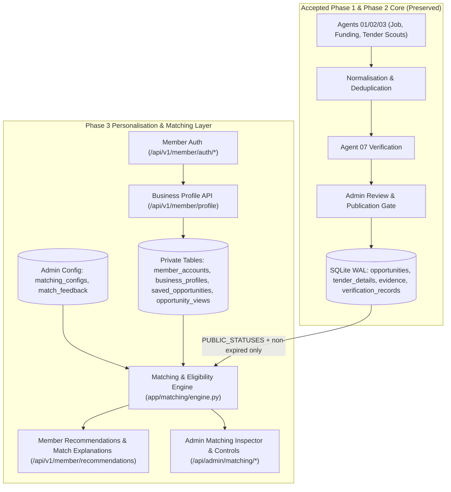

# BECCI Opportunity Engine — Phase 3 Architecture
## Business Profile, Opportunity Matching & Personalisation

**Date:** 2026-11-19  
**Version:** 3.0.0  
**Builds On:** Accepted Phase 1 (Job Scout, Funding Scout, Verification Agent) and Phase 2 (Tender Scout + Remediation)

---

## 1. Architectural Principles

1. **Extend, Do Not Rebuild:** Preserve the existing FastAPI application (`app/main.py`), SQLite WAL database (`data/becci.db`), 35 existing genuine opportunities, Agent 01/02/03/07 pipelines, and admin review workflow.
2. **Strict Data Separation:** Private member accounts, business profiles, saved bookmarks, and view history live in dedicated tables (`member_accounts`, `business_profiles`, `saved_opportunities`, `opportunity_views`) and are served exclusively through authenticated `/api/v1/member/*` endpoints. Public endpoints (`/api/v1/opportunities`, `/api/v1/tenders`) never expose member data.
3. **Publication & Verification Gate Integrity:** Automated matching and personalisation **never** bypass the existing Agent 07 verification and human publication workflow. Member recommendations query only opportunities in `PUBLIC_STATUSES` (`published`, `updated`, `closing_soon`) with `is_fixture = False`, and exclude expired or cancelled records from active recommendations.
4. **Explainable, Deterministic Matching:** Every recommendation includes a factor-by-factor score breakdown, human-readable match reasons, structured eligibility intelligence using the five controlled statuses, and a non-guarantee disclaimer.
5. **Reversible Schema Evolution:** All Phase 3 tables and indexes are managed through explicit migration `003_phase3_business_profiles_and_matching` in `app/migrations.py`.

---

## 2. System Component Architecture

---

## 3. Authentication & Access Isolation

| Principal | Token Format | Allowed Routes | Isolation Guarantee |
|---|---|---|---|
| **Public Anonymous** | None | `/api/v1/health`, `/api/v1/opportunities*`, `/api/v1/tenders*`, `/api/v1/categories`, `/api/v1/locations`, `/api/v1/sources` | Sees only published, verified, non-fixture opportunities. Zero access to member or admin data. |
| **BECCI Member** | `member\|<member_id>\|<ver>\|<exp>\|<sig>` (HMAC-SHA256) | `/api/v1/member/*` | Scoped strictly to `current_member.id`. Cannot read or modify another member's profile, saved items, or view history. Cannot access `/api/admin/*`. |
| **BECCI Admin / Reviewer** | `<username>\|<role>\|<ver>\|<exp>\|<sig>` (HMAC-SHA256) | `/api/admin/*` (including `/api/admin/matching/*`) | Role-gated (`viewer`, `reviewer`, `admin`). All config changes and false-positive flags are recorded in `audit_log`. |

---

## 4. Database Schema Additions (`003_phase3_business_profiles_and_matching`)

- `member_accounts`: Private member credentials and revocation version (`token_version`).
- `business_profiles`: Structured business profile attributes (sector, geography, stage, registration statuses, optional turnover/experience, licences, capabilities, products/services, preferred categories).
- `saved_opportunities`: Per-member bookmarked opportunities with optional private notes.
- `opportunity_views`: Per-member view counter and timestamps.
- `matching_configs`: Single-row (`id = "default"`) configurable scoring weights and safety flags.
- `match_feedback`: Admin review flags for false-positive matches or incomplete eligibility records.

---

## 5. Out-of-Scope Boundaries (Phase 3)

Per Phase 3 execution rules, this phase deliberately excludes:
- WhatsApp / SMS / email notification automation
- Voice assistants or conversational bots
- Public member-facing frontend UI
- Phase 4 BECCI website integration
