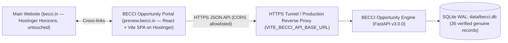

# BECCI Opportunity Engine — Phase 4 Integration Architecture
## Website Integration & Member Opportunity Portal

**Date:** 2026-11-19  
**Live Preview Portal (Hostinger):** `https://preview.becci.in`  
**Main BECCI Website (Preserved Untouched):** `https://becci.in` (Hostinger Horizons)  
**Staging Virtual API Tunnel:** `https://leaving-honors-friendly-generating.trycloudflare.com` → Local FastAPI `v3.0.0` (`127.0.0.1:8000`)

---

## 1. Separated Repository & Runtime Architecture

- **Backend Workspace:** `/Users/dhanushmakam/.gemini/antigravity/scratch/becci-opportunity-engine` (Python 3.12 / FastAPI)
- **Frontend Workspace:** `/Users/dhanushmakam/.gemini/antigravity/scratch/becci-opportunity-portal` (React 18 / TypeScript / Vite 5)
- Zero shared code or duplicated matching logic; all discovery, verification, matching, and eligibility calculations execute exclusively in the backend.

---

## 2. Environment Configuration (`VITE_BECCI_API_BASE_URL`)

| Environment | File | `VITE_BECCI_API_BASE_URL` |
|---|---|---|
| Development | `.env.development` | `http://127.0.0.1:8000` |
| Staging (Live Preview) | `.env.staging` | `https://leaving-honors-friendly-generating.trycloudflare.com` |
| Production Template | `.env.production.example` | `https://api.becci.in` (set at build time once VPS/cloud API is deployed) |

---

## 3. API Endpoint Mapping

| Frontend Route | Backend Endpoint(s) | Auth |
|---|---|---|
| `/`, `/opportunities` | `GET /api/v1/opportunities`, `GET /api/v1/metadata` | Public |
| `/opportunities/:id` | `GET /api/v1/opportunities/{id}`, optional `POST /api/v1/member/viewed/{id}`, `GET /api/v1/member/opportunities/{id}/match` | Public + optional Member Bearer |
| `/member/register` | `POST /api/v1/member/auth/register` | Public |
| `/member/login` | `POST /api/v1/member/auth/login` | Public |
| `/member/onboarding` | `GET /api/v1/member/profile`, `PUT /api/v1/member/profile`, `GET /api/v1/metadata` | Member Bearer |
| `/member/dashboard` | `GET /api/v1/member/recommendations`, `GET/POST/DELETE /api/v1/member/saved*`, `GET /api/v1/member/viewed` | Member Bearer |
| Footer Admin Link | `${VITE_BECCI_API_BASE_URL}/admin` | Admin Bearer (Backend-enforced) |
